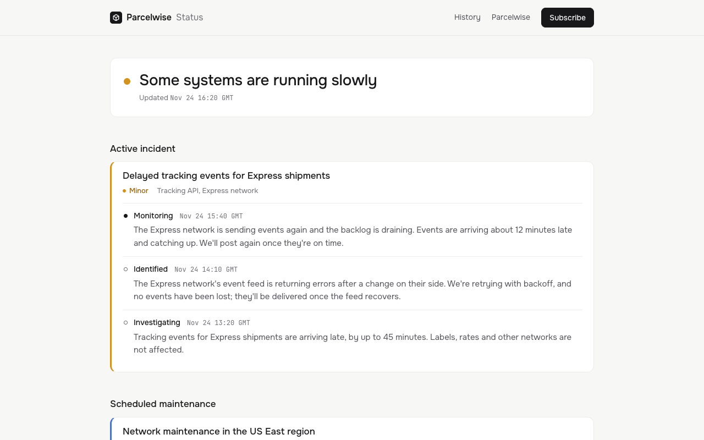

# Status page

A service status page: overall status, components with 90-day uptime bars, active and past incidents with their updates, scheduled maintenance, a subscribe form and a history page. Everything comes from one data file, and the site builds to plain static files.



[](https://console.cloudzyro.com/new?repo=https://github.com/Cloudzyro/template-status-page)

## What's included

- Overall status banner worked out from your components (operational, degraded, outage or maintenance)
- Active incidents with a timeline of updates (investigating, identified, monitoring, resolved)
- Scheduled maintenance with its window
- Components in groups, each with its current state, a 90-day uptime bar (30 days on phones), an uptime percentage and a tooltip per day
- Past 30 days on the home page, a history page grouped by month, and a page per incident
- Times shown in each visitor's own time zone (UTC without JavaScript)
- Subscribe form that posts to any form service, with an email fallback
- Light and dark, following the device setting
- SEO: page titles and descriptions, Open Graph and Twitter tags, `sitemap-index.xml`, `robots.txt`, favicon and a social image
- Responsive down to 360px, keyboard friendly, visible focus styles, respects reduced motion
- No tracking and no third-party scripts; fonts are self-hosted

## Run it locally

```bash
pnpm install
pnpm dev       # http://localhost:4321
pnpm build     # static site in dist/
pnpm preview   # serve the build
```

## Make it yours

**Everything is in [`src/data/status.ts`](./src/data/status.ts):** your service name and links, the component groups, incidents, planned maintenance and the subscribe text.

**Posting an incident.** Add an entry to `incidents` with an `id`, `title`, `impact` (`minor`, `major` or `maintenance`), the affected `components`, `startedAt` and a list of `updates`. Leave out `resolvedAt` while it's open, then add it with a `resolved` update when it's over. Set `updatedAt` to now and rebuild; the banner, component states, bars and uptime figures follow. Only `major` time counts as downtime in the uptime percentage; `minor` days show as degraded.

**Planned maintenance** goes in `maintenance` with its window as `startedAt` and `resolvedAt`. Once it has happened, move it into `incidents` with `completed` as its last update.

**Updating quickly.** Because the page is static, an update is a commit: edit the data file in GitHub's editor and your host rebuilds the site. Keep the status page on different hosting from the service it reports on, so it stays up when the service doesn't.

**Subscribe form.** Set a public environment variable to the address your form service gives you:

```bash
PUBLIC_FORM_ENDPOINT=https://formspree.io/f/your-form-id
```

The form posts `email` and `list` as form data, so it works with Formspree, Basin, a Supabase function or anything that accepts a form POST. Without it, the form says alerts aren't connected yet and offers an email link to `email` in the data file. Copy `.env.example` to `.env` for local development.

**Site address.** Set `SITE_URL` (or edit the fallback in `astro.config.mjs`) so the sitemap, `robots.txt` and social previews use your domain.

**Colors and fonts.** The neutrals and the four status colors are at the top of [`src/styles/global.css`](./src/styles/global.css), with a dark set below them. Fonts are Onest and JetBrains Mono from Fontsource, imported in `src/layouts/Base.astro`. Replace `public/og.png` (1200x630) and `public/favicon.svg` with your own.

## Deploy

Click **Deploy to Cloudzyro** above, or push your own copy to GitHub and connect the repository in the Cloudzyro console. The build command is `pnpm build` and the output is the static `dist/` folder, so no server is needed. Add `PUBLIC_FORM_ENDPOINT` and `SITE_URL` as environment variables before building.

## Stack

- [Astro](https://astro.build) 7, static output
- Hand-written CSS with custom properties
- [Fontsource](https://fontsource.org) self-hosted Onest and JetBrains Mono
- `@astrojs/sitemap`

## License

MIT, see [LICENSE](./LICENSE).
